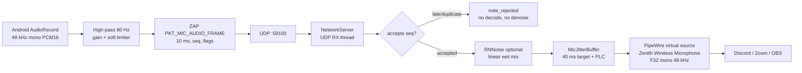

# Zenith Audio — Microphone Pipeline & Quality Work

> **Last updated:** 2026-11-07
> **App / server version:** 1.3.8 (`versionCode 11`)
> **Branch:** `feat/mic-quality` (stacked on `feat/mic-only-phone-only`, PR #2)
> **Scope:** phone → PC microphone path. The PC → phone playback path is only mentioned where it interacts with the mic (routing, echo, Discord).
> **Purpose:** reference for future maintainers and LLMs. It records the final architecture, every behavior change made during the quality work, the reasoning behind it, and the known gaps.

---

## 0. TL;DR

- The phone sends **48 kHz, mono, PCM16, 10 ms frames** (480 samples, 960 payload bytes, 980 bytes with the ZAP header) over **UDP 59100**.
- The server puts accepted packets into a **40 ms jitter buffer** with sequence handling and **PLC** (packet loss concealment). Late/duplicate packets are rejected **before** decoding/denoising.
- **RNNoise is optional** on the server, runs on accepted 10 ms frames, and is controlled by the app with a **0–100 % linear wet mix** (`0` = bypass, `100` = full denoise). It is **off by default** until the app requests a value.
- Android capture defaults to **`UNPROCESSED`**, the **built-in bottom mic**, **gain 0 dB**, and **NS 0 %**. The chosen source, input, gain and NS are persisted.
- The mic input list exposes physical mics and virtual routes with type, address (`bottom`, `back`), id, sample rates and channels. **Address is the stable identifier; numeric IDs are transient.**
- The server registers the virtual source as `Zenith Wireless Microphone`, a PipeWire `Audio/Source` (F32, mono, 48 kHz).
- Recommended tuning:
  - `UNPROCESSED` + NS **0–20 %** + Discord Krisp;
  - `MIC` + NS **70–100 %** + Krisp;
  - use **one** main noise suppressor; disable Discord's automatic input sensitivity when testing;
  - mic **gain** is not headphone volume.

---

## 1. Original problem and symptoms

Test device: **Poco X3 (M2007J20CG, Android 11, API 30)**, using headphones, Discord with Krisp.

Symptoms reported during the work:

| Symptom | Identified cause |
|---|---|
| Metallic / artificial voice, harsh “S”, hiss | Android `VOICE_COMMUNICATION` source applies AEC/NS/AGC tuned for calls; often band-limits or pumps. |
| Speech sounds **faster** and with cuts | The old server appended packets in arrival order with no sequence handling; a lost packet silently shortened the timeline. |
| Clicks / dropouts on Wi-Fi | No jitter buffer, no PLC, 20 ms PCM packets fragmented at the 1500-byte MTU, Wi-Fi power-save bursts. |
| Distant speech “disappears” | Aggressive OEM `MIC` processing and/or RNNoise being too strong/opaque; double suppression with Krisp. |
| Better sound with another mic | The Poco X3 exposes multiple physical mics/routes; the default route was not the best for the user's position. |
| Gain warning request | Mic gain affects only the uplink; headphone loudness is the phone's media volume / PC sink volume. |

The comparison baseline was **WO Mic on Windows over Wi-Fi**. WO Mic's documentation states PCM 48 kHz mono 16-bit, and Android's audio dump showed it used `src:MIC`. That confirmed the codec was never the differentiator; capture source, routing and network handling were.

---

## 2. Final architecture



### Threads and ownership

| Component | Thread | Owns |
|---|---|---|
| `MicAudioRecorder` | `ZenithMicRecordThread` (`URGENT_AUDIO`) | `AudioRecord`, HPF, gain, limiter, packetization |
| `UdpAudioReceiver` mic sender | `Zenith-Mic-Tx` (max priority) | Bounded queue (16), UDP send of mic frames |
| `UdpAudioReceiver` other control | `netIoExecutor` (single thread) | Pings, feedback, control packets |
| `NetworkServer` | UDP RX thread | Parsing ZAP, mic callback, control dispatch |
| `MicJitterBuffer` | producer: UDP RX consumer: PipeWire RT | Sequence, PLC, latency cap, stats |
| `MicNoiseSuppressor` | UDP RX thread | RNNoise state, wet mix (atomic), processed counter |
| `PipeWireMicSink` | PipeWire loop thread | Stream, `pull()` into F32 buffers |
| `AudioEngine` stats | stats thread | `[STATS]` and `[MIC]` log lines |

RNNoise is deliberately **not** run on the PipeWire RT thread. It runs on accepted packets on the UDP RX thread. Late/duplicate packets never reach the decoder or RNNoise.

---

## 3. ZAP microphone protocol

See also [`protocol/PROTOCOL.md`](../protocol/PROTOCOL.md).

### Header (20 bytes, big-endian, packed)

| Field | Type | Mic use |
|---|---|---|
| `magic` | `uint16` | `0x5A41` |
| `version` | `uint8` | `1` |
| `type` | `uint8` | `PKT_MIC_AUDIO_FRAME = 0x09` |
| `seq_num` | `uint32` | Monotonic per mic session; used for reorder/gap/PLC |
| `timestamp_us` | `uint64` | Sender monotonic time (not used by the jitter buffer) |
| `payload_size` | `uint16` | Payload byte count |
| `flags` | `uint16` | bit 1 = discontinuity, bit 2 = mic PCM |
| payload | bytes | 10 ms PCM16 (960 bytes) or Opus |

### Flags

- `FLAG_MIC_PCM = 0x0004` — payload is PCM16 mono 48 kHz.
- `FLAG_DISCONTINUITY = 0x0002` — first packet / new capture session. The server resets RNNoise and the jitter sequence.
- `FLAG_FEC_PRESENT = 0x0001` — reserved/used by the PC→phone Opus path.

### Control commands

| Code | Command | Field | Meaning |
|---|---|---|---|
| `0x01` | `CMD_SET_BITRATE` | `target_bitrate` | PC→phone Opus bitrate |
| `0x02` | `CMD_RESYNC` | — | Request resync |
| `0x03` | `CMD_PAUSE` | — | Stop PC→phone audio; mic stays active |
| `0x04` | `CMD_RESUME` | — | Resume PC→phone audio |
| `0x05` | `CMD_SET_VOLUME` | `param16` 0–100 | Set PC default sink volume |
| `0x06` | `CMD_MIC_STATE` | `param16` 0/1 | Phone mic on/off notification |
| `0x07` | `CMD_SET_PC_MUTE` | `param16` 0/1 | Mute PC speakers; capture monitor remains |
| `0x08` | `CMD_SET_MIC_NS` | `param16` 0–100 | RNNoise wet mix; `0` bypass, `100` full |

### Compatibility for `CMD_SET_MIC_NS`

- Current app (`ZapProtocol.buildMicNoiseSuppressionPacket`) writes the clamped percentage into **both** `param16` and `target_bitrate`.
- Current server (`NetworkServer::handle_incoming_packet`) prefers `param16`; if `param16 == 0` and `target_bitrate` is `1..100`, it uses `target_bitrate` for older clients.
- This makes new app → old server and old app → new server work.
- Earlier app builds only wrote `target_bitrate`; the fallback exists for them.

### Why 10 ms frames

A 20 ms PCM16 mono frame is 1920 bytes + 20 header = **1940 bytes**, larger than the 1500-byte MTU, so it becomes **two IP fragments**. Losing either fragment loses the whole frame. 10 ms is 960 + 20 = **980 bytes**, fits one datagram, and gives PLC 10 ms granularity.

---

## 4. Android implementation

Key files:

- `android/app/src/main/java/com/zenith/audio/mic/MicAudioRecorder.kt`
- `android/app/src/main/java/com/zenith/audio/network/UdpAudioReceiver.kt`
- `android/app/src/main/java/com/zenith/audio/service/AudioReceiverService.kt`
- `android/app/src/main/java/com/zenith/audio/protocol/ZapProtocol.kt`
- `android/app/src/main/java/com/zenith/audio/MainActivity.kt` (mic settings dialog)

### 4.1 Capture sources (`MicSourceMode`)

| Mode | Android source | Notes |
|---|---|---|
| `UNPROCESSED` (default) | `MediaRecorder.AudioSource.UNPROCESSED` → `VOICE_RECOGNITION` → `MIC` → `VOICE_COMMUNICATION` | Rawest; may expose the phone's own hiss; best with a clean physical mic. |
| `VOICE_RECOGNITION` | `VOICE_RECOGNITION` → `MIC` → `UNPROCESSED` → `VOICE_COMMUNICATION` | Speech-tuned middle ground. |
| `MIC` | `MIC` → `VOICE_RECOGNITION` → `UNPROCESSED` → `VOICE_COMMUNICATION` | OEM default; on MIUI may include its own NS/AGC and pump at low levels. |
| `VOICE_CALL` | `VOICE_COMMUNICATION` → `MIC` | Full call processing; best for phone-speaker use, not studio quality. |

Legacy pref migration: stored `"RAW"` → `UNPROCESSED`; `"VOICE_CALL"`/`"CALL"` → `VOICE_CALL`.

### 4.2 Input device discovery and identity

Data comes from `AudioManager.getDevices(AudioManager.GET_DEVICES_INPUTS)`; each `AudioDeviceInfo` supplies:

- `type` (`TYPE_BUILTIN_MIC`, `TYPE_TELEPHONY`, `TYPE_WIRED_HEADSET`, `TYPE_BLUETOOTH_SCO`, `TYPE_USB_*`, …),
- `address` (`bottom`, `back`, `0`/empty for virtual routes),
- `productName`,
- `id` (transient; may change after reboot),
- `sampleRates`, `channelCounts`,
- `isSource`.

Important facts:

- Android has **no public `TYPE_BACK_MIC` constant**. The Poco X3 HAL reports `AUDIO_DEVICE_IN_BACK_MIC` but `AudioDeviceInfo` exposes it as built-in/unknown; the app detects it by `address == "back"`.
- `AudioDeviceInfo.getAddress()` is **API 28+**; the app guards it with `Build.VERSION.SDK_INT >= P`. Without the guard, `NoSuchMethodError` (`Error`, not `Exception`) crashes Android 8/8.1 when listing mics.
- The list filters out non-mic routes: `TYPE_REMOTE_SUBMIX`, `TYPE_FM_TUNER`, `TYPE_TV_TUNER`, and addresses containing `echo`/`reference`.
- The list is sorted: recommended bottom built-in first, then physical devices, then virtual routes.
- `Telephony` is labelled virtual; unknown types fall back to `Input`.

Stable resolution:

1. If a stored **address** exists and matches a device, use that device. If the stored **id** still agrees with that address, keep the specific id (several routes can share `bottom`).
2. If the id is missing/stale but the address matches, use the address match.
3. If the id is valid and its address matches (or the address is blank), use the id.
4. Fall back to the **built-in bottom** mic, then the first built-in, then any remaining source.
5. On API < 28, addresses are unavailable; the id is used.

The chosen input is persisted as `mic_input_device_id` + `mic_input_device_address`. The dialog resolves the initial selection against the current device list and only persists a concrete address when the user explicitly picks a device (or when the resolved address is already known). This avoids baking a stale id into prefs after a reboot.

### 4.3 DSP

- **High-pass filter:** 80 Hz, 2nd-order biquad. Removes DC, handling rumble and low-frequency noise.
- **Gain:** slider `-12..+24 dB`, default **0 dB**. It is **microphone input gain**, not headphone volume.
- **Soft limiter:** threshold ~0.9; only shapes peaks; prevents hard PCM clipping. It cannot repair an overdriven mic.
- **No AGC, no noise gate, no de-esser** by default. The goal is a clean raw signal for Discord/Krisp/RNNoise.
- **VU meter:** RMS over ~100 ms, based on processed samples.

### 4.4 Packetization and sending

- 48 kHz mono PCM16, `FRAME_SAMPLES = 480`, `FRAME_BYTES = 960`.
- First packet of every session has `FLAG_DISCONTINUITY`.
- Mic frames use a **dedicated sender thread** (`Zenith-Mic-Tx`, max priority) with a bounded 16-packet queue; if full, the oldest is dropped so latency cannot grow.
- Pings/feedback/control use a separate single-thread executor.
- `WifiManager.WifiLock` (`WIFI_MODE_FULL_LOW_LATENCY` on API 29+, else `WIFI_MODE_FULL_HIGH_PERF`) is held while streaming.
- RNNoise strength is sent as `CMD_SET_MIC_NS` on mic start, on setting change, and replayed by `UdpAudioReceiver.resendControlState()` after a reconnect/server restart.

### 4.5 Settings and persistence (`zenith_prefs`)

| Key | Default | Meaning |
|---|---|---|
| `mic_source_mode` | `UNPROCESSED` | `UNPROCESSED`, `VOICE_RECOGNITION`, `MIC`, `VOICE_CALL` |
| `mic_input_device_id` | `-1` | `-1` = prefer built-in bottom; else current Android device id |
| `mic_input_device_address` | `""` | Stable physical address (`bottom`, `back`) |
| `mic_gain_db` | `0f` | -12..24 dB |
| `mic_ns_percent` | `0` | RNNoise wet mix 0..100 |
| `server_ip`, `known_server_ips` | app defaults | Connection |
| `pc_audio_enabled`, `phone_only` | `true`, `false` | Routing (mic-only / phone-only) |

Existing installs may still have `mic_ns_percent = 100` from earlier testing; the default for a fresh install is 0. The app never silently overrides a stored value.

### 4.6 Mic settings dialog

Shows:

- capture mode chips (`UNPROCESSED`, `VOICE`, `MIC`, `CALL`);
- input device list with **name + details** (`id`, address, max rate, channels, product, virtual route);
- active source and actual **Route** from `AudioRecord.routedDevice` (the real HAL route, not just the requested one);
- gain slider with a warning: mic input, not headphone volume;
- noise suppression slider with the recommendation (`UNPROCESSED` 0–20 %, `MIC` 70–100 %);
- battery-optimization hint (MIUI is aggressive with background audio).

---

## 5. Server implementation

Key files:

- `server/include/mic_jitter_buffer.hpp`
- `server/include/mic_noise_suppressor.hpp`
- `server/src/pipewire_mic.cpp` (+ `include/pipewire_mic.hpp`)
- `server/src/audio_engine.cpp`
- `server/src/network_server.cpp`
- `server/Makefile`
- `protocol/protocol.hpp`

### 5.1 `MicJitterBuffer`

Constants/behavior:

| Item | Value |
|---|---|
| Sample rate | 48 kHz mono |
| Target playout reserve | **1920 samples = 40 ms** |
| Max extra allowed | **1920 samples = 40 ms** (total cap ~80 ms) |
| Idle reset | **500 ms** without packets → back to prefill/silence, no endless PLC |
| Max concealed gap | **150 ms** (time-based; works for 10 ms and 20 ms frames) |
| Frame capacity | 2048 samples per packet |
| Output ring | 65536 floats (~1.36 s) |

Sequence decision (`SeqAction`): `Restart`, `Accept`, `Duplicate`, `Late`.

- `accepts(seq, discontinuity)` and `will_restart(...)` share `classify()` with `push_float()`.
- `will_restart` ignores the first packet of the process lifetime (the RNNoise state is already fresh).
- `note_rejected()` increments received/late without touching the timeline; used when the denoiser rejects a packet before push.
- On a gap, PLC repeats the last accepted/denoised frame with decay (up to 150 ms).
- On overflow, the consumer `skip()` drops the oldest samples to keep latency bounded.
- `pull()` always returns exactly the requested samples: PCM, concealment or silence.
- `pcm16_to_float()` is the single int16→float conversion helper (guard: `bytes >= 2`, capacity).
- `push_pcm()` was removed as dead API; the sink converts with `pcm16_to_float()` and calls `push_float()`.

Stats: `packets_received`, `packets_lost`, `packets_late`, `plc_frames`, `underruns`, `overruns`, `skipped_samples`, `denoised_frames`, `buffer_fill_ms`.

### 5.2 `MicNoiseSuppressor` (RNNoise)

- Optional at build time: `ZENITH_HAVE_RNNOISE` from `pkg-config rnnoise` / `RNNOISE_CFLAGS` + `RNNOISE_LIBS`.
- `rnnoise_create()` in constructor; `available()` reads atomic `linked_`.
- RNNoise expects **480-sample (10 ms) frames at 48 kHz**, float samples in int16 scale (`*32768` in, `/32768` out).
- Wet mix is **linear**:
  - `0 %` = bypass, no model advance;
  - `100 %` = full RNNoise;
  - intermediate = parallel dry/wet.
- Default `wet_mix_ = 0.0` (bypass) until `CMD_SET_MIC_NS`.
- `reset()`:
  - destroys/recreates `DenoiseState`,
  - updates atomic `linked_`,
  - clears `reset_requested_`.
- Reset is requested on:
  - `FLAG_DISCONTINUITY` / sequence-0 restart (via `will_restart`),
  - transition 0 % → >0 % after the model has processed frames (avoids resuming from a stale estimate).
- `processed_frames_` atomic counts actual RNNoise frames; exposed through `PipeWireMicSink::get_stats()` and the `[MIC] NS:` log field.
- Short trailing samples (<480) are left dry; the app sends exact 480-sample frames.

### 5.3 `PipeWireMicSink`

- Creates a PipeWire `Audio/Source` named `zenith-mic`, description `Zenith Wireless Microphone`.
- Format: **F32, mono, 48 kHz**; node latency `480/48000` (10 ms).
- `push_audio_frame()`:
  1. if `will_restart(seq, discontinuity)` → `noise_suppressor_.reset()`;
  2. if `!accepts(seq, discontinuity)` → `note_rejected()` and return (no decoder, no RNNoise);
  3. PCM: `pcm16_to_float()`; zero-sample payload → `note_rejected()`; else RNNoise → `jitter_buffer_.push_float()`;
  4. Opus: decode only after `accepts()`; then RNNoise → push.
- `process_audio()` uses `pw_buffer::requested` (fallback 480), clamps to buffer maxsize, calls `jitter_buffer_.pull()`, sets chunk offset/stride/size.
- `get_stats()` merges jitter stats + `denoised_frames`.
- `set_noise_suppression_percent()` clamps 0..100, stores wet mix, logs `Denoiser mix set to N%`.

### 5.4 `AudioEngine`

- Creates/starts the **mic sink before the transport RX thread**; registers the mic frame callback and control callback before `transport_->start()`. This removed a race where a fast `CMD_SET_MIC_NS` could be dropped or `mic_sink_` read concurrently.
- `CMD_SET_MIC_NS` → `mic_sink_->set_noise_suppression_percent(param)`.
- Stats thread logs:
  ```text
  [MIC] Recv: +N | Lost: +N | Late: +N | PLC: +N | Underrun: +N | Overrun: +N | Skip: +Nms | NS: +N | Buffer: Nms
  ```
- `stop()` stops source/transport, joins worker/stats, then stops the mic sink.

### 5.5 `NetworkServer`

- Mic callback signature now carries `(data, size, is_pcm, seq, timestamp_us, discontinuity)`.
- `CMD_SET_MIC_NS` dispatch prefers `param16`; legacy fallback to `target_bitrate` when `param16 == 0` and `target_bitrate` is 1..100.
- `PKT_MIC_AUDIO_FRAME` is accepted from any client; client sessions are registered/refreshed only for session traffic.
- Stale clients are swept after 8 s; PC mute ownership is restored on disconnect.

### 5.6 Build

`server/Makefile`:

- `CXXFLAGS`/`LDFLAGS` use `override` so command-line flags cannot silently drop RNNoise defines/link flags.
- RNNoise detection via `pkg-config rnnoise`; overridable with `RNNOISE_CFLAGS`/`RNNOISE_LIBS`.
- `.rnnoise-state` is a **FORCE-driven stamp**: its content (`on`/`off`) is rewritten only when availability changes; objects depend on it, so toggling RNNoise rebuilds without `clean`.
- `make clean all` in one invocation works; the default goal remains `all`.
- `install.sh` installs RNNoise development packages **optionally** (`|| echo`), so a distro without the package still installs the server without NS.

Local RNNoise setup used on this machine (not required by the repo):

```bash
# RPMs extracted under ~/.local/opt/rnnoise
make -C server clean all -j"$(nproc)" \
  RNNOISE_CFLAGS="-I$HOME/.local/opt/rnnoise/usr/include" \
  RNNOISE_LIBS="-L$HOME/.local/opt/rnnoise/usr/lib64 -lrnnoise -Wl,-rpath,$HOME/.local/opt/rnnoise/usr/lib64"
```

The resulting binary has an RPATH to that local directory. If the directory is removed, the server may fail to start (`librnnoise.so.0` missing). A system `rnnoise-devel` install avoids this.

---

## 6. Recommended settings

| Source | Noise suppression | Why |
|---|---|---|
| `UNPROCESSED` | **0–20 %** | Raw signal + correct physical mic is clean; let Krisp handle residual. |
| `VOICE_RECOGNITION` | 30–50 % | Middle ground. |
| `MIC` | **70–100 %** | OEM processing adds its own noise/artifacts; RNNoise cleans them. |
| `VOICE_CALL` | 0–20 % | Already heavily processed. |

Other rules:

- Use **one main suppressor**. RNNoise 80–100 % + Krisp is acceptable if it sounds good; otherwise reduce one. Distant speech disappearing is the sign of double gating.
- In Discord:
  - input = `Zenith Wireless Microphone`;
  - Krisp on;
  - echo cancellation off when using headphones;
  - **automatic input sensitivity off**; set the slider manually;
  - one noise suppressor at a time.
- If the voice is quiet: raise **mic gain** (+3/+6 dB) and/or move closer. The soft limiter protects peaks; high gain still amplifies hiss.
- If the hiss is high: use `UNPROCESSED` + NS 0–20 %, or `MIC` + 70–100 %; check the physical mic (bottom vs back).
- If distant speech mutes: lower NS, disable Discord auto-sensitivity, avoid stacking NS + Krisp at maximum.
- If the wrong mic is chosen: open the gear, compare `Route:` with the list, select `Built-in mic · bottom` / `Back mic · back` explicitly. The “recommended” chip forces bottom.

---

## 7. Build, install, verify

### Android

AGP 8.3 does **not** run on Java 25. Use JDK 21:

```bash
cd android
JAVA_HOME=/tmp/opencode/jdk21 \
ANDROID_HOME="$HOME/Android/Sdk" \
ANDROID_SDK_ROOT="$HOME/Android/Sdk" \
./gradlew :app:assembleRelease --no-daemon
```

The APK is `android/app/build/outputs/apk/release/app-release.apk`.

Install:

```bash
adb devices
adb -s <serial> install -r release_artifacts/zenith-audio-v1.3.8-ocr-followup.apk
```

Wireless-debugging serials change after reboot; use `adb devices`. The release key in this fork is the debug keystore, so updates install over previous builds.

### Server

```bash
make -C server clean all -j"$(nproc)"
systemctl --user stop zenith-server
cp server/bin/zenith-server "$HOME/.local/bin/zenith-server"
systemctl --user start zenith-server
systemctl --user status zenith-server
```

If the server was built with a local RNNoise prefix, pass the flags shown in §5.6.

### Runtime checks

```bash
systemctl --user is-active zenith-server
journalctl --user -u zenith-server -f | grep -E "RNNoise|Denoiser|\[MIC\]"
```

Expected:

```text
[PipeWireMic] RNNoise noise suppression: ON
[PipeWireMic] Denoiser mix set to 80%
[MIC] Recv: +100 | Lost: +0 | Late: +0 | PLC: +0 | Underrun: +0 | Overrun: +0 | Skip: +0ms | NS: +100 | Buffer: 40ms
```

- `NS: +100` proves RNNoise processed ~100 frames (10 ms each) in the interval.
- `NS: +0` with a nonzero stack means bypass (0 %) or RNNoise unavailable.
- `RNNoise noise suppression: OFF` means the server was built without the library.

Check the loaded library:

```bash
pid=$(pgrep -f '/home/.*/\.local/bin/zenith-server' | head -1)
grep rnnoise /proc/$pid/maps
```

### Protocol synthetic test (no phone)

Send a ZAP `PKT_CONTROL_REQ` with `CMD_SET_MIC_NS`:
- `param16 = 30`, `target_bitrate = 0` → logs `Denoiser mix set to 30%`.
- `param16 = 0`, `target_bitrate = 60` → legacy fallback logs `60%`.

This validates `NetworkServer` + `AudioEngine` + `PipeWireMicSink` control plumbing without the phone.

### Unit tests

The jitter/sequence/RNNoise tests used during development live outside the repo (`/tmp/opencode/mic_fix_test.cpp`). They cover:

- prefill/output before/after 40 ms;
- loss inserts PLC and preserves timeline;
- burst latency bounded;
- underrun concealment;
- duplicate/late rejection;
- sequence-0 restart;
- idle reset;
- only accepted packets are denoised;
- RNNoise full-wet increments `processed_frames`;
- 0 % bypass does not process;
- `reset()` recreates the model.

**Known gap:** these tests are not committed to `test/` or CI. See §10.

---

## 8. Troubleshooting

| Problem | Checks / fix |
|---|---|
| No microphone audio | RECORD_AUDIO permission; app foreground service (microphone type); mic “TURN ON”; server connected; `wpctl status` shows `Zenith Wireless Microphone`; Discord input device. |
| `Route:` is not what was selected | The HAL ignored `setPreferredDevice`; select the device explicitly; on Android 8/8.1 addresses are unavailable (API guard) and the id path is used. |
| Speech sounds faster / cuts | Server `[MIC] Lost/PLC/Underrun`. Old server skipped lost packets; 1.3.8 uses PLC. If all zero, look at Discord auto-sensitivity or Android battery optimization. |
| Clicks on Wi-Fi | Check `Lost`, `Underrun`, `Overrun`, `Skip`. `Skip` is the latency cap working. Ensure WifiLock; try 5 GHz or USB tethering; disable MIUI battery restrictions. |
| Hiss | `UNPROCESSED` raw + correct mic at 0–20 % NS, or `MIC` + 70–100 %; Krisp on. High mic gain amplifies hiss; the limiter does not remove it. |
| Distant speech disappears | Lower NS; disable Discord auto input sensitivity; avoid double suppression; raise mic gain moderately; check RNNoise 100 % is linear full-wet (no hidden backoff). |
| Metallic/artificial voice | Do not use `VOICE_COMMUNICATION` for normal Discord use; use `UNPROCESSED` or `MIC`; ensure only one strong suppressor. |
| Echo | Phone speaker playing PC audio while the mic is on; use mic-only mode or headphones. The phone’s AEC and Discord AEC cannot fully cancel PC-speaker bleed. |
| `RNNoise OFF` | The server was built without `rnnoise-devel`/flags. Install the package (`rnnoise-devel`, `librnnoise-dev`, `rnnoise` on Arch) and rebuild; or pass local flags. |
| Server fails to start after moving the binary | The local RPATH points to `~/.local/opt/rnnoise/usr/lib64`; install the system package or rebuild with the flags. |
| Android 8/8.1 crash opening mic settings | Fixed in 1.3.4+ with the API 28 `getAddress()` guard. Update the APK. |
| Mic list shows duplicates/“Input” | Multiple audio profiles/routes; the back mic is identified by `address=back`, virtual routes by type; details show id/rate/channels. |
| Gain warning confusion | Gain is the mic uplink level; headphone volume is the phone’s media volume or the PC sink. The app warns in both places. |

---

## 9. Known limitations / next steps

1. **Tests are not in the repo/CI.** Move the jitter/RNNoise tests to `test/`, add CTest/CI, and an end-to-end test: synthetic PCM → server → `zenith-mic` recording + `NS: +N` assertion.
2. **`MainActivity.kt` is 2,006 lines** (mic dialog, device list, callbacks embedded). Extract `MicSettingsDialog`/`MicSettingsViewModel`.
3. **`MicAudioRecorder.kt` is 622 lines** mixing capture, DSP, device enumeration and packetization. Split into `MicDeviceRepository`, `MicDsp`, `MicPacketizer`, `MicRecorder`.
4. **RNNoise portability.** The current binary uses a local RPATH; prefer vendored/static RNNoise or a hard/system dependency. `install.sh` installs it optionally; a `make` without the package silently builds `OFF`.
5. **`PipeWireMicSink::stop()` lifecycle.** If `thread_main` fails before creating the loop and sets `is_running_ = false`, `stop()` returns without joining a joinable `loop_thread_`; the `std::thread` destructor can terminate. Make `stop()` always join a joinable thread.
6. **Partial frames.** `MicNoiseSuppressor::process()` leaves a trailing <480-sample tail dry. The app sends exact 480, but a malformed/short PCM payload gets `note_rejected()` and a one-packet PLC gap.
7. **Windows server** has the mic callback type but no virtual microphone sink; the mic path is Linux-only.
8. **The app does not encode Opus for the mic.** The server can decode Opus mic frames, but the app sends PCM. Opus would cut 768 kbps to ~80–128 kbps and improve loss resilience on congested Wi-Fi.
9. **No source-aware NS preset.** The dialog recommends values, but the user still chooses. A future “Auto” could map `UNPROCESSED`→0–20, `MIC`→70–100.
10. **No fresh OCR after 1.3.8.** The last review covered 1.3.7 + fixes; the final 1.3.8 commit was not re-reviewed.
11. **PROTOCOL.md port** was stale (8088); corrected to 59100 in this docs change.
12. **Branch/PR hygiene.** `feat/mic-quality` is stacked on PR #2 (`feat/mic-only-phone-only`). The new work has no separate PR; a stacked PR would include the parent commits until PR #2 merges.
13. **Kotlin deprecation warnings** remain (`LinearProgressIndicator`, `VolumeUp/Mute` icons, `PhoneStateListener`); pre-existing, non-blocking.
14. **Current code quality assessment:** ~7.5/10. Server is modular and build-tested; Android is functional but monolithic; the largest debt is the missing committed test suite/CI.

---

## 10. File map

| Path | Responsibility |
|---|---|
| `android/.../mic/MicAudioRecorder.kt` | Source/device selection, AudioRecord, HPF/gain/limiter, 10 ms packetization, settings, device list/details |
| `android/.../network/UdpAudioReceiver.kt` | UDP socket, mic sender thread, NS resend, control/feedback/ping |
| `android/.../service/AudioReceiverService.kt` | Foreground service, mic lifecycle, prefs, WifiLock, settings bridge |
| `android/.../protocol/ZapProtocol.kt` | Packet builders, including `buildMicNoiseSuppressionPacket` |
| `android/.../MainActivity.kt` | Mic settings dialog + UI (currently ~2,006 lines) |
| `server/include/mic_jitter_buffer.hpp` | Jitter buffer, `SeqAction`, PLC, idle reset, stats |
| `server/include/mic_noise_suppressor.hpp` | Optional RNNoise, linear wet mix, reset, counter |
| `server/src/pipewire_mic.cpp` | Virtual source, accepted-packet gate, NS, PipeWire pull |
| `server/src/audio_engine.cpp` | Start order, callbacks, stats log |
| `server/src/network_server.cpp` | ZAP parsing, mic callback, control dispatch/fallback |
| `protocol/protocol.hpp` | Wire structs/enums |
| `protocol/PROTOCOL.md` | Protocol contract |
| `server/Makefile` | Optional RNNoise, FORCE stamp, override flags |
| `install.sh` | Optional RNNoise packages, build/install/service |
| `docs/mic-audio-pipeline.md` | This document |

---

## 11. Version / commit history

The current work is stacked on PR #2 (`feat/mic-only-phone-only`) and the VPN discovery fix. Key mic-quality commits:

| Version | Commit | Summary |
|---|---|---|
| 1.3.0 | `2a7d368` | Makefile header dependency tracking (with `-MMD`) |
| 1.3.0 | `6b2da8b` | Server mic jitter buffer + PLC base |
| 1.3.0 | `0b67ee1` | Ignore generated `.d` files |
| 1.3.1 | `c6ea1ec` | Raw capture, built-in mic preference, gain/HPF/limiter, 10 ms frames, dedicated sender, WifiLock, mic settings dialog |
| 1.3.1 | `7329eb3` | Version bump |
| — | `5453660` | Treat sequence restart as a new session |
| — | `394b343` | Idle reset of concealment + delta stats |
| 1.3.2 | `0d1d8a6` | Selectable mic sources |
| — | `ebc1a01` | Optional RNNoise base |
| — | `cab58b0` | NS control/level-aware mix (later replaced by linear mix) |
| 1.3.3 | `db2a3a4` | NS control in the app + version |
| 1.3.4 | `7389816` | Detailed mic info + address persistence |
| 1.3.5 | `55a8d16` | Gain/output-volume warnings |
| — | `2a55fab` | Only accepted/in-order packets denoised; reset per session |
| 1.3.6 | `01ca817` | Clarify NS slider behavior |
| 1.3.7 | `7a21564` | Server hardening (param16, optional build, decode gate) |
| 1.3.7 | `1182cc4` | Android hardening (API 28 guard, address/ID, NS replay) + version |
| 1.3.8 | `6321497` | Sink-before-transport, FORCE stamp, lifecycle cleanup |
| 1.3.8 | `52a2f61` | Android address backfill, ID fallback, NS compatibility + version |

Base commits from PR #2 include `473c766` (VPN discovery), `7d5ba4d` (mic-only/phone-only), `b805e52` (client session registration).

The current branch is `feat/mic-quality`, tracking `fork/feat/mic-quality` (`luanweslley77/zenith-audio`). The upstream is `origin` (`mohduwaisghosi786-stack/zenith-audio`). PR #2 remains open and untouched by this work.

---

## 12. Decision log (why it is this way)

- **10 ms PCM, not 20 ms:** avoids IP fragmentation and gives 10 ms PLC granularity; 980 bytes fits MTU 1500.
- **40 ms jitter buffer, 80 ms cap:** a microphone can tolerate 40–60 ms; it absorbs Wi-Fi jitter, power-save bursts and the 20 ms frame spacing of older clients. Without it, the server played late packets immediately and time-compressed speech.
- **PLC / concealment:** a lost packet must not shorten the timeline. The buffer repeats the last accepted frame with decay; after 150 ms it stops inventing audio.
- **Only accepted/in-order packets are denoised:** late/duplicate frames would otherwise corrupt the stateful RNNoise/Opus models before being discarded.
- **RNNoise before the jitter buffer (accepted packets only):** RNNoise expects fixed 480-sample frames; the jitter buffer manages the sample timeline. PLC repeats the last denoised frame.
- **Linear 0–100 % wet mix:** the earlier level-dependent dry/wet floor was opaque and made `100 %` not actually 100 % at low levels. The user controls the trade-off; 0 is a true bypass.
- **NS default 0:** no processing without user opt-in; a lost control packet leaves the server bypassed, not unexpectedly processed.
- **Raw source default:** `VOICE_COMMUNICATION` produced metallic/AGC/hiss artifacts; raw + the correct physical mic + RNNoise/Krisp sounds better.
- **Built-in bottom default:** headset/Bluetooth mics may be narrowband; the bottom built-in is usually the primary voice mic. The user can choose the back mic when it fits their position.
- **Address + id resolution:** Android ids can change after reboot; addresses (`bottom`, `back`) are stable. Several routes can share an address, so a matching id is kept when it agrees with the address.
- **Optional RNNoise:** the server must build on systems without the dev package; the log and `NS:` counter make the state visible. `install.sh` attempts the package but does not abort.
- **Mic sink before transport:** avoids the data race on `mic_sink_` and losing a fast `CMD_SET_MIC_NS`; the transport RX thread starts after the sink exists.
- **No AGC/gate:** Discord/Krisp and RNNoise handle noise; AGC/gates caused pumping and distant-speech muting.

### Do not

- Do not default to `VOICE_COMMUNICATION` for Discord/headphones.
- Do not use 20 ms PCM packets or assume the MTU is larger than 1500.
- Do not feed late/duplicate packets to RNNoise or the Opus decoder.
- Do not set a nonzero NS default without the user's choice.
- Do not trust the numeric audio device id across reboots; use the address.
- Do not bake an address derived from a stale id at startup.
- Do not confuse mic gain with headphone volume.
- Do not stack RNNoise at 100 % with maximum Krisp without listening for distant-speech dropouts.
- Do not assume `RNNoise ON` means audio is being denoised; check `NS: +N` and the mix log.
- Do not read `PROTOCOL.md` port 8088 as current; code uses **59100**.

---

## 13. Glossary

- **AGC** — automatic gain control; can pump and amplify noise.
- **AEC** — acoustic echo cancellation.
- **NS** — noise suppression/denoising.
- **PLC** — packet loss concealment; fills missing audio with a short continuation/fade.
- **Jitter buffer** — holds a small reserve to absorb irregular packet arrival.
- **RNNoise** — lightweight recurrent-neural-network denoiser for 48 kHz mono; 10 ms frames.
- **PCM16** — signed 16-bit linear PCM.
- **MTU** — maximum IP packet size on the link (1500 on standard Ethernet/Wi-Fi).
- **HAL** — Android hardware abstraction layer that reports audio device types/addresses.
- **Virtual source** — PipeWire `Audio/Source` fed by the server; applications see it as a microphone.
- **Wet mix** — fraction of the denoised signal in the output; 0 = dry/bypass, 1 = fully denoised.

---

## 14. Context for a future LLM

If you are continuing this work:

1. Start with `server/include/mic_jitter_buffer.hpp`, `server/include/mic_noise_suppressor.hpp`, `server/src/pipewire_mic.cpp`, and `android/.../MicAudioRecorder.kt`.
2. Preserve these invariants:
   - 48 kHz mono PCM16, 10 ms frames, ZAP `PKT_MIC_AUDIO_FRAME`;
   - late/duplicate packets rejected before decode/NS;
   - RNNoise linear 0–100 %, default 0, reset on session restart;
   - jitter buffer 40 ms target / 80 ms cap / 500 ms idle reset / 150 ms max PLC;
   - address-first mic identity, id only when it agrees with the address;
   - mic sink before transport start;
   - no silent RNNoise opt-in.
3. The largest missing piece is committed tests/CI and an end-to-end audio test.
4. The biggest code smell is `MainActivity.kt` (2,006 lines); extract the mic settings UI before it grows.
5. If modifying the protocol, update `protocol/protocol.hpp`, `protocol/PROTOCOL.md`, `ZapProtocol.kt`, `NetworkServer`, and the app/server fallback behavior together.
6. Run `make -C server clean all` (not just incremental) after RNNoise availability changes, or rely on the `.rnnoise-state` stamp.
7. Use JDK 21 for the Android build; Java 25 fails with AGP 8.3.
8. Verify with `journalctl --user -u zenith-server -f | grep -E "RNNoise|Denoiser|\[MIC\]"` and look for `NS: +N`.
