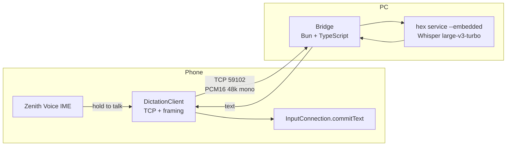

# Zenith Audio — Phone Dictation (design)

> **Last updated:** 2026-11-08
> **Status:** design only. Nothing in this document is implemented yet.
> **Branch:** `feat/phone-dictation`, stacked on `feat/mic-quality` (which is stacked on PR #2).
> **Scope:** phone microphone → PC speech recognition → text inserted on the phone or on the PC.
> **Purpose:** record the decisions before the code exists, so the implementation does not drift into a worse architecture.

---

## 0. TL;DR

- The phone already sends **48 kHz mono PCM16, 10 ms frames** to the PC over ZAP/UDP 59100.
- Speech recognition runs on the **PC**, using **Hex** (`hex service --embedded`) as a library, with **Whisper large-v3-turbo** and `language: pt` by default. Stock Parakeet v3 is not used: its Portuguese training data is European Portuguese and it cannot be told which language to output (§2.3).
- A small **bridge** process on the PC accepts the dictation audio over **TCP**, builds a WAV, asks Hex for the text, and returns it on the same connection.
- The phone gets the text through a **custom Android IME** (a voice keyboard) and inserts it with `InputConnection.commitText()`.
- **The trigger decides the destination.** Press the phone keyboard's mic → text goes to the phone. Press the PC hotkey → text goes to the PC. No router and no synchronized target selector.
- The batch path (one WAV per utterance) is the v1. Live partial text is a later, separate feature.

---

## 1. Goal and non-goals

### Goal

Use the phone as the only microphone, run the heavy speech model on the PC, and insert the recognized text **where the user is typing** — which may be the phone or the PC.

### Non-goals (v1)

- Replacing ZAP or changing the real-time microphone path used by Discord/Zoom.
- Voice commands or LLM post-processing (punctuation, rewriting, "translate this").
- Live partial text while the user is still speaking.
- Multiple simultaneous dictation users/devices.
- Cloud speech recognition. Everything stays on the LAN and on the PC.

---

## 2. Current state and constraints

### 2.1 Zenith today

| Item | Value |
|---|---|
| Phone → PC audio | UDP 59100, ZAP, 48 kHz mono PCM16, 480-sample (10 ms) frames |
| Jitter buffer | 40 ms target, 80 ms cap, PLC up to 150 ms |
| PC virtual source | PipeWire `Audio/Source` "Zenith Wireless Microphone", F32 mono 48 kHz |
| Android capture | `MicAudioRecorder` (622 lines) with source/device selection, HPF, gain, limiter |
| Settings | `zenith_prefs` (`SharedPreferences`), already shared by activity and service |
| Discovery | `ServerDiscovery` (UDP probe/beacon), result stored as `server_ip` |
| PC → phone audio | Independent Opus path; not relevant here |

The virtual microphone already makes the phone usable by any PC app. **The missing piece is not audio; it is text coming back.**

### 2.2 Hex (verified 2026-11-08)

Hex is a local dictation app written in Rust, MIT licensed. It does not accept pull requests, so it is consumed as a black box.

Two relevant surfaces:

| Surface | What it does | Fit for this project |
|---|---|---|
| `hex service --embedded` + TypeScript SDK (`@kitlangton/hex`) | Loads a model, accepts **WAV 8–192 kHz, 1–8 channels**, returns text. No microphone access. Keeps the model loaded between calls. | **Primary.** No resampling, no lease, no SSE. |
| `POST /streams` (live transcription) | Requires a running Hex with a GGUF model; `16 kHz` mono only; one stream at a time; 10 s lease; SSE events with partial/segment/final. | Later, only if live text is wanted. |

Facts that shaped the decision:

- `hex service [--embedded]` serves the same local API as the running app, including `/streams`, and is designed for host-owned audio.
- The SDK is published (`@kitlangton/hex`, ESM, Node >= 20.3, no runtime dependencies) and works with Bun.
- Upload limits: 64 MiB per clip, 8–192 kHz, 1–8 channels. At 48 kHz mono PCM16, 64 MiB ≈ 11 minutes; our own cap is much lower.
- `transcribe()` never downloads a model; `create({ model })` downloads and loads one. The first call can therefore be slow.
- **Streaming models** in the catalog (at this commit): `parakeet_unified_en` (English only) and `nemotron_3_5_asr` (multilingual, includes `pt`). **`parakeet_v3`, `parakeet_ultra`, `whisper_large_v3_turbo` do not stream.**
- `parakeet_ultra` is Labs-gated. `parakeet_v3` is the stable multilingual default, but for Brazilian Portuguese it is the **wrong** choice: NVIDIA's card says its Portuguese training data is **European Portuguese**, and the model takes no language prompt, so it auto-detects and can drift (see §2.3).
- Models are Q8_0 GGUF, roughly **740–890 MB** each, so two copies fit in the RX 6500 XT's 4 GB, but running two engines is still wasteful.
- On Linux, inference uses Vulkan when available and falls back to the CPU. The window still needs a Vulkan driver even for CPU inference. `hex service --embedded` is the path that avoids the window, but it must be verified headless (see §12).
- On KDE Wayland, Hex pastes through the **RemoteDesktop portal** (not `wtype`), and Live Typing (input-method preedit) is **not** available on KWin.

### 2.3 Choosing the Portuguese model

The model choice matters more than any code in this document. Parakeet v3 is not a safe default for pt-BR:

- NVIDIA's model card, evaluation note 2: *"our training data uses European Portuguese while most benchmarks use Brazilian Portuguese."* Vocabulary and accent are pt-PT, not pt-BR.
- The model **has no language input or output**. NVIDIA closed the request for one with *"unfortunately parakeet-v3 model doesn't receive or output language id"* (NVIDIA-NeMo/Speech#14799). It guesses from the audio.
- Because it guesses, short spans are unstable: a reported 90 s pt-BR recording came out in Portuguese, while a 25 s slice of the same audio came out in fluent English. For hold-to-talk dictation (a few seconds), that is the worst possible failure mode.

Options with external evidence (Portuguese WER from a public pt-BR comparison; prepared = read speech, spontaneous = natural speech):

| Model | Prepared | Spontaneous | pt-BR fit | Hex |
|---|---|---|---|---|
| pt-BR Parakeet fine-tune (`-plus`, published) | **7.5%** | **14.3%** | Portuguese by construction, no language detection to fail | Not public; the published numbers are this checkpoint |
| `whisper_large_v3_turbo` | 8.4%* | 23.4%* | Good; the `pt` hint prevents the Parakeet-style silent language switch | Native, GPU, 886 MB |
| `parakeet_v3` (stock) | 9.0% | 21.8% | Risky: pt-PT training, no language control, English drift | Native, GPU, 740 MB |
| `nemotron_3_5_asr` | — | 20.7%** | Worse; streaming is its advantage | Native, GPU, 751 MB |
| `qwen3_asr06_b`, `cohere_transcribe`, `granite_speech_5` | — | — | Unknown for pt-BR; no benchmark found | Native |

\* Whisper **large-v3** numbers; turbo is ~0.4 WER points behind on English benchmarks, so expect a similar small gap.
\*\* A single 90 s pt-BR recording, not a benchmark; treat as indicative.

Measured on this machine on 2026-11-08 (same audio for every model; see §16 for the corpus). The fine-tune row is the **`-30s`** checkpoint, not the published `-plus`:

| Model | FLEURS (read, 50 clips) | TAGARELA (spontaneous, 10 clips) | CLI median, per clip |
|---|---|---|---|
| `-30s` fine-tune (Q8_0) | 7.60% raw · **4.05%** without digit sentences | **18.44%** | **0.73 s** |
| `whisper_large_v3_turbo` (Q8_0) | **5.00%** raw · 4.50% without digit sentences | 22.95% | 4.51 s |
| `parakeet_v3` stock (Q8_0) | 5.36% raw · 4.50% without digit sentences | 21.31% | 0.75 s |

The fine-tune's raw FLEURS number is inflated by **number formatting**, not recognition: it writes "mil e quatrocentos" where the reference has "1.400". On the 42 clips without digits it leads. On spontaneous speech — the closest to dictation — it leads clearly, and it is ~6× faster than Whisper on CPU.

Decision (2026-11-08):

- **Chosen:** the `-30s` pt-BR Parakeet fine-tune (`alexandreacff/parakeet-tdt-v3-ptBR-30s`), imported as `custom-7d13a4fb474b2100`. It is v3-based (8192-token multilingual tokenizer), runs on Vulkan through Hex, and measured 4.05% on FLEURS without digit sentences and 18.44% on TAGARELA spontaneous.
- **`-plus` is not available.** Third-party cards (`alefiury`'s ONNX, `luizhrocha`'s GGUF) point to `alexandreacff/parakeet-tdt-0.6b-v3-ptBR-plus`, but the repo answers 401 and the author's public profile lists only `-30s`, `-20s`, `tagarela-v2` and `distil-whisper-tagarela-v2`. Do not build the plan on it; revisit only if the author publishes it or shares the `.nemo`.
- **`tagarela-v2` is a different lineage,** not a newer `-30s`: it is Parakeet **v2** (English) with a **1024-token English** tokenizer (`en_mm_ytc/tokenizer_spe_bpe_v1024`), while `-30s` is Parakeet **v3** with an 8192-token multilingual tokenizer. Its vocab has 2 tokens containing `ç`/`ã`/`ção` against 14 in the `-30s` vocab, so it is likely worse for pt-BR; not pursued.
- **Whisper remains the fallback** if the `-30s` model fails on the user's voice.
- **Do not** ship stock `parakeet_v3` for pt-BR.
- **Number formatting:** the fine-tune spells numbers out. If digits are wanted, add an inverse text normalization step later; do not change the acoustic model for it.

Sibling checkpoints, for the record:

| Repo | Base | Tokenizer | Status |
|---|---|---|---|
| `parakeet-tdt-v3-ptBR-30s` | Parakeet v3 (multilingual) | 8192 BPE | **chosen**, imported |
| `parakeet-tdt-v3-ptBR-20s` | Parakeet v3 (multilingual) | 8192 BPE | public sibling, untested |
| `parakeet-tdt-0.6b-v3-ptBR-plus` | Parakeet v3 (per the ONNX vocab) | 8192 BPE | private/removed; not reachable |
| `parakeet-tdt-tagarela-v2` | Parakeet v2 (English) | 1024 English BPE | likely worse for pt-BR; not pursued |

Beware of the already-published pt-BR GGUF (`luizhrocha/parakeet-tdt-0.6b-v3-ptBR-gguf`): it was converted with **parakeet.cpp**, so its metadata uses `parakeet.encoder.*` instead of transcribe.cpp's `stt.parakeet.encoder.*` and `stt.variant`. Hex cannot load it as-is; it is useful only if the bridge runs `parakeet-cli` instead of Hex.

### 2.4 What this rules out

- **Not** integrating ASR into `zenith-server`. The server is the audio transport; adding HTTP/JSON/SSE/WAV to it would couple every dictation change to a restart of the microphone path.
- **Not** using `/streams` for v1. It needs the desktop app running, only accepts 16 kHz, and its partials depend on the model. The batch WAV path is simpler and model-agnostic.
- **Not** sending the transcript over UDP without an acknowledgement layer. For a short dictated sentence, TCP is the correct tool.
- **Not** resampling 48 → 16 kHz in the batch path. The embedded service accepts 48 kHz directly.

---

## 3. Architecture



### 3.1 Three components, three responsibilities

| Component | Owns | Does not own |
|---|---|---|
| **Zenith Voice IME** (Android) | Microphone capture during dictation, TCP client, text insertion | Speech recognition, language models |
| **Bridge** (PC, separate process) | Framing, WAV assembly, Hex lifecycle, error mapping | Audio capture, text insertion |
| **Hex** (PC) | Model, inference | Where the text goes |

### 3.2 Why TCP instead of reusing ZAP/UDP

ZAP is optimized for a **continuous real-time stream**: low latency, loss tolerance, jitter buffer, PLC. Dictation has the opposite requirements:

| Requirement | Real-time call | Dictated sentence |
|---|---|---|
| Latency while capturing | Critical | Irrelevant (a few hundred ms are invisible) |
| Loss tolerance | Conceal and continue | **Zero** — a lost packet loses a word |
| Ordering | Buffer and reorder | Must be exact |
| Duration | Minutes | Seconds |
| Transport | UDP | **TCP** |

Analogies: UDP is a postcard — fast, but if it is lost, it is gone. TCP is a registered letter — it is re-sent until it arrives, in order. A phone call needs the postcard; a sentence needs the letter.

Reusing ZAP would also mean duplicating the jitter buffer and PLC in the bridge, and binding a second listener to the server's port. A separate TCP port keeps the dictation path independent: it works while Discord is muted, while the phone is in mic-only mode, or while the server is stopped.

Consequence to accept: **RNNoise and the jitter buffer do not run on this path.** That is intentional. RNNoise is a speech enhancer tuned for calls; ASR models are trained on noisy speech and do not need it. The capture chain still applies the 80 Hz high-pass, gain and soft limiter, because those are cheap and shared with the existing recorder.

### 3.3 Why the trigger decides the destination

The original plan proposed a target selector ("PC" / "Phone") synchronized between devices. It is unnecessary:

- To insert text on the phone, the user is looking at a phone field, so the **phone keyboard is on screen**. Its mic button starts a phone-target session.
- To insert text on the PC, the user is at the PC and presses the **Hex hotkey**. Hex handles it as it always did.

The device that starts the dictation is the device that receives the text. A selector would add shared state, a synchronization channel and a new failure mode (text landing on the wrong device) to solve a problem the UI already solves.

### 3.4 Why the bridge is a separate process

- It can crash, restart or be upgraded without touching the audio server or the running microphone.
- It can be written in TypeScript and use the official Hex SDK without adding a C++ HTTP client, JSON parser or SSE implementation to `zenith-server`.
- It is testable with a WAV file and `nc`; no phone required.
- If Hex changes, only the bridge changes.

Cost: one more process and a systemd unit. Accepted.

---

## 4. Wire protocol (phone ↔ bridge)

One TCP connection per dictation. The connection **is** the session; no session IDs are needed.

Default port: **59102/TCP**.

### 4.1 Frame

```text
+--------+------------------+----------------------+
| type   | length (u32 BE)  | payload              |
| 1 byte | 4 bytes          | `length` bytes       |
+--------+------------------+----------------------+
```

- Maximum frame payload: 1 MiB.
- Audio frames must have an even length (PCM16 samples).
- A frame larger than the limit, or a truncated frame, closes the connection with `bad-frame`.

### 4.2 Types

| Type | Name | Payload |
|---|---|---|
| `0x01` | `DICTATION_START` | UTF-8 JSON (see below) |
| `0x02` | `AUDIO` | Raw PCM16LE, 48 kHz, mono |
| `0x03` | `DICTATION_END` | Empty |
| `0x81` | `RESULT` | UTF-8 JSON |
| `0x82` | `ERROR` | UTF-8 JSON |

`DICTATION_START`:

```json
{
  "version": 1,
  "sampleRate": 48000,
  "channels": 1,
  "format": "s16le",
  "language": "pt",
  "model": "whisper_large_v3_turbo",
  "token": "optional-shared-secret"
}
```

- Invalid JSON or a missing required field is `bad-request`. A supported JSON shape with wrong values (for example 16 kHz or stereo) is `unsupported-format`.
- `language` and `model` are optional. When omitted, the bridge uses its configured defaults. The bridge's configuration wins: a client may ask for a different model, but the bridge refuses it with `bad-request` unless it is the configured one. `language` is **required** for Whisper (it prevents drift); Parakeet and GigaAM ignore it.
- `token` is optional in v1 and enforced when the bridge is configured with one (see §8).

`RESULT`:

```json
{
  "version": 1,
  "text": "Criar uma função que soma dois números.",
  "model": "whisper_large_v3_turbo",
  "language": "pt",
  "durationMs": 8200,
  "inferenceMs": 410
}
```

`ERROR` codes:

| Code | Meaning |
|---|---|
| `bad-frame` | Truncated frame, oversized frame or unknown type |
| `bad-request` | Invalid `DICTATION_START` JSON or missing fields |
| `unsupported-format` | Not 48 kHz mono PCM16 |
| `audio-too-large` | Over the configured duration/byte cap |
| `model-unavailable` | Hex binary missing, model not installed or load failed |
| `model-busy` | Another dictation is being transcribed and the queue is full |
| `transcription-failed` | Hex returned an error |
| `timeout` | Transcription exceeded the deadline |
| `internal` | Anything else |

### 4.3 Order and termination

```text
client → START
client → AUDIO × N
client → END, then half-closes its write side
server → RESULT or ERROR, then closes
```

- The bridge ignores `AUDIO` after `END`.
- The client must not send a second `START` on the same connection.
- If the client disconnects before `END`, the bridge discards the audio (cancel semantics).
- The text is UTF-8 and may be empty (silence or unrecognized speech); the IME then inserts nothing.

### 4.4 Chunk size

The recorder produces 10 ms frames. The client accumulates **100 ms** (4 800 samples, 9 600 bytes) before writing. Rationale: no real-time deadline; fewer syscalls; a 5-byte header on 9 600 bytes is 0.05 % overhead. Losing up to 100 ms on a crash is irrelevant.

---

## 5. Android IME

### 5.1 Component

`ZenithImeService : InputMethodService`

Manifest additions:

```xml
<service
    android:name=".ime.ZenithImeService"
    android:permission="android.permission.BIND_INPUT_METHOD"
    android:exported="true">
    <intent-filter>
        <action android:name="android.view.InputMethod" />
    </intent-filter>
    <meta-data
        android:name="android.view.im"
        android:resource="@xml/method" />
</service>
```

`res/xml/method.xml` declares the subtype (`pt-BR`, keyboard mode) and points at the app's settings for configuration.

### 5.2 UI

A compact voice keyboard, **not** a full QWERTY:

- a large press-and-hold microphone button;
- a status line ("Conectando…", "Ouvindo…", "Transcrevendo…");
- a cancel button while recording;
- a keyboard-switch button (`switchToNextInputMethod`) so the user can return to Gboard;
- a settings shortcut (server IP, bridge port, model, language).

The PC address comes from the existing `server_ip` preference, filled by `ServerDiscovery`; the bridge port defaults to `59102` and is stored next to it. No new pairing UI is required.

Use classic Android Views for v1. Compose inside an IME needs a `ComposeView` plus a lifecycle owner and adds failure modes for no user benefit in a screen with three controls. The main activity already uses Compose; the IME can stay on Views until it grows.

### 5.3 Capture

Reuse `MicAudioRecorder` **as-is** for v1:

```kotlin
MicAudioRecorder(
    context = this,
    sendAudioPacket = { frame -> dictationClient.enqueue(frame) },
    sendControlPacket = { /* no-op: ZAP controls do not apply here */ }
).apply { applySettings(readMicSettings(), restartIfRecording = false) }
```

This gives dictation the same source mode, input device, gain and limiter the user configured for calls. The noise-suppression control packet is ignored, which is correct: RNNoise is not part of this path. `start()` returns `false` when the device or permission is unavailable; the IME must surface that and close the connection instead of recording.

Refactor only if the class grows: extract `MicDsp` (high-pass, gain, limiter) and a `MicFrameSink` interface. Do not rewrite it for the MVP.

### 5.4 Sending

`DictationClient` runs a writer thread with a bounded queue (e.g., 5 s of audio):

- `enqueue(frame)` never blocks the audio thread.
- If the queue fills, the session aborts locally with `network-slow` instead of silently dropping words.
- On release: `END`, `socket.shutdownOutput()`, then read the reply with a 120 s timeout.

### 5.5 Insertion

```kotlin
val ic = currentInputConnection
if (ic != null) {
    ic.commitText(text, 1)
}
```

- `commitText` inserts and moves the cursor. It is the only general mechanism; a normal app cannot write into another app's field.
- If the connection is null (the user switched apps), discard the text and show a notification/toast.
- For live partials later, use `setComposingText` (underlined provisional text) and `finishComposingText` — never commit partials repeatedly.
- Fields that report no text input (`TYPE_NULL`) and apps that block third-party IMEs will refuse insertion. This is a platform limit, not a bug. (Password fields are fine: an IME is allowed to type into them.)

### 5.6 State machine

```text
Idle ──press──▶ Connecting ──ok──▶ Recording ──release──▶ Waiting ──text──▶ Inserting ──▶ Idle
  ▲                   │                  │                    │
  └────error/cancel───┴──────────────────┴────────────────────┘
```

- **Cancel** (button, back, screen off): stop capture, close the socket without `END`, return to `Idle`.
- **Timeout**: 120 s waiting for the result, then show an error and close.
- **Permission missing**: open the main activity to request `RECORD_AUDIO` (same app, so a grant covers the IME too).
- **PC unreachable**: show "PC indisponível" with the configured address and a shortcut to the settings; do not start recording.
- **Minimum hold**: shorter than ~300 ms → "segure e fale", no request.

### 5.7 Do not

- Do not run the IME's capture while the Zenith mic service is also capturing, unless concurrent capture is verified on the device. Prefer to pause the service during dictation; Android 11 on the Poco X3 may give the audio to only one client.
- Do not keep the screen awake with a wakelock for a hold-to-talk gesture; the IME is visible and focused while the key is held.
- Do not commit `""` (it can clear a selection); skip empty results.

---

## 6. Bridge

### 6.1 Runtime

**Bun + TypeScript** on the PC.

Reasons: Bun is already installed; the official Hex SDK is TypeScript/ESM-only; the bridge is I/O-bound; iteration is faster than C++ or Rust. The SDK targets Node >= 20.3, and Bun aims for Node compatibility, but this must be verified — if the SDK rejects Bun, run the bridge on Node with no code change. If it ever needs to be a single binary, port it to Rust later; the protocol is the contract, not the language.

### 6.2 Responsibilities

1. Accept TCP connections on `0.0.0.0:59102` (configurable).
2. Parse frames, validate `DICTATION_START`.
3. Buffer audio up to `maxSeconds` (default 120 s) and `maxBytes` (default 16 MiB).
4. On `END`, build a WAV in memory.
5. Call Hex, serialize requests (one inference at a time), return `RESULT`/`ERROR`.
6. Close the connection.

### 6.3 Hex lifecycle

- `create({ command: ["hex", "service", "--embedded"], model, language })` on first dictation (lazy) or at service start (warm).
- Keep the transcriber alive across sessions; `close()` after `idleUnloadMs` (default 10 min) to release VRAM, then recreate on demand.
- Model download happens on the first `create()` and can take minutes; log progress and fail the session with `model-unavailable` until it is ready.
- One inference at a time. The engine is single-threaded; a second concurrent request answers busy. The bridge queues at most one connection and rejects further ones with `model-busy`.
- Pin the model and language in the bridge configuration; do not depend on the desktop app's current selection.

### 6.4 WAV

Mono, 16-bit PCM, 48 kHz, no resampling:

```text
RIFF <size> WAVE
fmt  (16 bytes): PCM=1, channels=1, rate=48000, byteRate=96000, blockAlign=2, bits=16
data <bytes>
```

44-byte header plus the buffered samples. Reject odd-length audio.

### 6.5 Configuration

| Option | Default | Meaning |
|---|---|---|
| `--port` | `59102` | TCP listen port |
| `--model` | `whisper_large_v3_turbo` | Hex model id |
| `--language` | `pt` | Hint; required for Whisper, ignored by Parakeet/GigaAM |
| `--max-seconds` | `120` | Audio cap per dictation |
| `--max-bytes` | `16777216` | Hard byte cap |
| `--idle-unload` | `600` | Seconds before closing the Hex engine |
| `--token` | empty | Shared secret required in `START` when set |
| `--log-transcripts` | `false` | Never log text by default |

### 6.6 Service

A user unit, `zenith-dictation.service`, with `Restart=on-failure`, logs to the journal. The bridge must start after the network is up but does not need the Zenith server.

---

## 7. Lifecycle of one dictation

```text
1. User focuses a text field on the phone and selects the Zenith Voice keyboard.
2. User presses and holds the mic key.
3. IME opens TCP to the PC, sends START, starts AudioRecord.
4. Every 10 ms the recorder emits PCM16; the client buffers and writes 100 ms frames.
5. User releases.
6. IME stops the recorder, sends END, half-closes.
7. Bridge builds a WAV and calls Hex.
8. Hex returns the text.
9. Bridge sends RESULT and closes.
10. IME calls commitText(text, 1) and returns to Idle.
```

PC-target dictation does not use the bridge:

```text
1. User is at the PC and presses Hex's hotkey.
2. Hex captures from "Zenith Wireless Microphone" (the phone's audio).
3. Hex transcribes and pastes into the focused PC app.
```

---

## 8. Security and privacy

- The bridge listens on the LAN. Anyone who can reach port 59102 can make the PC transcribe audio (resource abuse), but cannot read files or run code.
- **v1:** bind to the LAN and document it. **v1.1:** generate a token on the PC, store it in `zenith_prefs` on the phone, require it in `START`. The protocol already carries the field, so enforcing it is not a breaking change.
- No TLS. Do not expose the port through the router; if remote use is needed, use a VPN (WireGuard) — the same assumption ZAP already makes.
- Transcripts are not logged by default. Hex's own History is a separate feature; the bridge does not write text to disk.
- Audio and text stay on the LAN and on the PC. No cloud provider is involved unless the user deliberately configures one in Hex (not part of this design).

---

## 9. Latency budget

For a 10-second utterance, LAN, GPU inference:

| Step | Typical |
|---|---|
| Last 100 ms chunk flush after release | 0–100 ms |
| TCP on Wi-Fi | 1–5 ms |
| WAV assembly | < 5 ms |
| Hex inference (Whisper large-v3-turbo, ~19× realtime, Hex benchmark) | ~530 ms |
| Return + `commitText` | < 10 ms |
| **Total after release** | **~0.6–1.5 s** |

Notes:

- The 19× figure is Hex's benchmark on its own hardware, not a guarantee for the RX 6500 XT. CPU fallback can be several times slower. Parakeet is faster (~33×) but unsuitable for pt-BR (§2.3).
- The first dictation after the engine was unloaded adds model load time (seconds). Keep the engine warm if that hurts.
- The budget excludes the initial model download.

---

## 10. Alternatives considered

| Alternative | Why not |
|---|---|
| **Integrate ASR into `zenith-server`** | Adds HTTP/JSON/WAV/SSE and model management to the C++ audio path; every change restarts the microphone; couples two very different lifecycles. |
| **Use Hex `/streams` live API** | Requires the desktop app (or a service) holding a model; 16 kHz only; one stream; lease management. Batch WAV is simpler for v1. Revisit only for live text. |
| **Android `SpeechRecognizer`** | On-device model choice is limited, quality is below Parakeet/Whisper, and the user explicitly wants the PC's compute. |
| **Clipboard only** | Works today (and KDE Connect can sync clipboards), but requires a manual paste every time. Kept as a fallback and as a Phase 0 validation tool, not as the product. |
| **Accessibility Service** | Can type into other apps, but is fragile across apps, visible to the user as a security-sensitive service, and restricted by Play policy. The IME is the supported mechanism. |
| **Send text over ZAP/UDP** | Needs acknowledgements, retries, deduplication and fragmentation — i.e. reimplementing TCP. |
| **A separate ZAP listener on the PC** | Cannot share the port cleanly; duplicates jitter/PLC; packet loss becomes lost words. |

---

## 11. Phases and acceptance criteria

| Phase | Work | Acceptance |
|---|---|---|
| **0 — Validate (zero code)** | Install Hex (RPM), `hex model install whisper_large_v3_turbo`, choose "Zenith Wireless Microphone" as Hex's microphone, dictate in Portuguese with the phone. Also install `parakeet_v3` and repeat a few short phrases to confirm the pt-BR drift described in §2.3. | Whisper text appears in a KDE app; quality is acceptable; latency measured. No English drift on short phrases. |
| **0.5 — validate on the user's voice** | Record 10–15 phrases (numbers, names, accents, code terms) once. Transcribe the same WAVs with the chosen `-30s` model, Whisper and stock v3. Score errors by hand. | The `-30s` model stays the default unless it fails badly on this speaker; the run also provides the reference recordings for the bridge tests. |
| **1 — Bridge + test button** | Implement the bridge and a "Test transcription" button in the existing app (or a tiny debug screen) that sends 5 s of audio and shows the result. | Round trip < 2 s for a 10 s utterance; text matches Phase 0 for the same audio; the main error paths (`model-unavailable`, `timeout`, `audio-too-large`) are reachable and shown. |
| **2 — IME** | Implement `ZenithImeService`, capture, TCP client, `commitText`, cancel and state machine. | Works in WhatsApp, Chrome and Notes; text lands at the cursor; cancel discards; screen-off stops; no ANR. |
| **3 — Polish** | Model/language picker, token pairing, undo (`deleteSurroundingText`), PC-target shortcut, optional live text with `nemotron_3_5_asr`. | Each item independently verified. |

Phase 0 is not optional. It answers the biggest unknown — does the model understand this user's Brazilian Portuguese through this microphone? — before any code exists. Phase 0.5 decides the model with evidence instead of a model card.

---

## 12. Open questions

1. **Does `hex service --embedded` start headless on Fedora KDE Wayland** without a display? It needs a Vulkan ICD; the docs say the window needs a driver even for CPU inference. Test before Phase 1.
2. **VRAM:** one 740–890 MB model is fine; two (desktop + bridge) are probably fine on 4 GB, but Vulkan overhead is unknown. Decide whether the bridge unloads after idle.
3. **Quality on the user's voice:** confirm the chosen `-30s` model against Whisper and stock v3 on the same recordings. The published `-plus` numbers are not a target; that checkpoint is not public.
4. **GGUF conversion and Hex import:** resolved — the pt-BR fine-tune was converted (§16), imported as `custom-7d13a4fb474b2100`, checked on the RX 6500 XT via Vulkan, and transcribed the smoke samples correctly. Remaining: run it on the user's voice.
5. **Concurrent capture:** IME + `AudioReceiverService` at the same time on the Poco X3/MIUI. If only one wins, pause the service during dictation.
6. **KDE paste (Phase 0 only):** Hex uses the RemoteDesktop portal on KWin. Confirm it works on this Fedora version.
7. **MIUI battery restrictions:** the IME is foreground while visible, so it should be exempt, but verify long holds.

---

## 13. Planned file map

| Path | Responsibility |
|---|---|
| `docs/phone-dictation.md` | This document |
| `android/.../ime/ZenithImeService.kt` | InputMethodService, view, state machine, `commitText` |
| `android/.../ime/DictationClient.kt` | TCP connection, frame codec, writer queue, reply parsing |
| `android/.../ime/DictationProtocol.kt` | Frame types and JSON models shared with the bridge tests |
| `android/app/src/main/res/xml/method.xml` | IME declaration and subtypes |
| `android/app/src/main/res/layout/ime_voice.xml` | Voice keyboard layout |
| `android/app/src/main/AndroidManifest.xml` | Service + `BIND_INPUT_METHOD` |
| `bridge/package.json` | Bun project, `@kitlangton/hex` dependency |
| `bridge/src/index.ts` | TCP server, session lifecycle |
| `bridge/src/frames.ts` | Frame codec |
| `bridge/src/wav.ts` | PCM16 → WAV |
| `bridge/src/hex-client.ts` | Hex lifecycle and transcription queue |
| `bridge/src/config.ts` | Flags and defaults |
| `bridge/zenith-dictation.service` | systemd user unit |
| `bridge/test/frames.test.ts` | Frame codec, WAV header, oversized/truncated frames |
| `bridge/test/session.test.ts` | Cancellation, timeouts, error mapping |
| `android/app/src/test/java/com/zenith/audio/ime/` | Frame codec and state-machine unit tests |

---

## 14. Decision log

- **Batch, not streaming, for v1.** A dictated sentence is a short file, not a call. The WAV path removes resampling, leases, SSE and model-streaming constraints.
- **TCP for dictation.** Reliability and ordering matter more than milliseconds when the payload is a sentence.
- **Separate bridge process.** Isolates failures and keeps the C++ audio server untouched.
- **Trigger decides destination.** No router, no synchronized selector.
- **Reuse `MicAudioRecorder` in the IME.** Same source, device, gain and limiter; no second capture implementation.
- **Whisper with a language hint for pt-BR.** It is the safe native fallback that handles Brazilian Portuguese and prevents the output language from silently changing.
- **The `-30s` pt-BR fine-tune is the chosen model**, validated on read and spontaneous speech and imported into Hex (§16). The `-plus` checkpoint is not public; `tagarela-v2` is a 1024-token English lineage and was rejected.
- **Do not log transcripts by default.** Voice text is sensitive.
- **Phase 0 before code.** The model's Portuguese quality is the real risk, not the plumbing.
- **Do not trust a model card's language list.** "Portuguese" can mean pt-PT; test on the speaker.
- **Number formatting is not a recognition error.** Do not pick a model by raw WER when one spells numbers and the other emits digits.

### Do not

- Do not add a text packet to ZAP for v1; ZAP is the real-time audio path.
- Do not resample 48 → 16 kHz for the batch path.
- Do not run the bridge inside `zenith-server`.
- Do not send the transcript over UDP without acknowledgements.
- Do not use `/streams` without the desktop app running.
- Do not run two Hex engines if VRAM becomes a problem; unload one.
- Do not commit partial text; use composing text if live text is ever added.
- Do not use stock `parakeet_v3` for pt-BR; it is trained on European Portuguese and has no language control.
- Do not assume a Parakeet model honors a language hint; Parakeet and GigaAM take none.
- Do not treat a missing `InputConnection` as recoverable; discard and tell the user.

---

## 15. References

- Hex repository: <https://github.com/anomalyco/hex>
- Hex live streams contract: `docs/streams.md` in that repository
- Hex TypeScript SDK: <https://www.npmjs.com/package/@kitlangton/hex>
- Hex Linux notes (Vulkan, paste, Live typing): `docs/linux.md` in that repository
- Parakeet v3 model card (see evaluation note 2, European Portuguese): <https://huggingface.co/nvidia/parakeet-tdt-0.6b-v3>
- No language id in Parakeet v3 (NVIDIA): <https://github.com/NVIDIA-NeMo/Speech/issues/14799>
- pt-BR fine-tune and Portuguese WER comparison: <https://huggingface.co/alefiury/parakeet-tdt-0.6b-v3-ptBR-TAGARELA-onnx>
- pt-BR Parakeet checkpoint: <https://huggingface.co/alexandreacff/parakeet-tdt-v3-ptBR-30s>
- transcribe.cpp GGUF converter (Hex's engine): <https://github.com/handy-computer/transcribe.cpp>
- Zenith mic pipeline: [`docs/mic-audio-pipeline.md`](mic-audio-pipeline.md)
- Zenith protocol: [`protocol/PROTOCOL.md`](../protocol/PROTOCOL.md)

---

## 16. Appendix: converting the pt-BR Parakeet fine-tune (validated)

**Status (2026-11-08):** converted, quantized, **imported into Hex** (`custom-7d13a4fb474b2100`) and verified on the RX 6500 XT via Vulkan. `hex model transcribe` matches the reference on the smoke samples.

### 16.1 What was converted

| Item | Value |
|---|---|
| Checkpoint | `alexandreacff/parakeet-tdt-v3-ptBR-30s` (public, CC-BY-4.0) |
| Source | 2.5 GB `.nemo` (POSIX tar: `model_config.yaml`, `model_weights.ckpt`, `*_tokenizer.model`) |
| Engine | `handy-computer/transcribe.cpp` |
| Converter | `scripts/convert-parakeet.py` |
| Variant slug | `parakeet-tdt-v3-ptBR-30s` |
| Output | 706 MB Q8_0 GGUF |

The converter dispatches on the output directory's slug, so the profile key must match it. The entry added:

```python
"parakeet-tdt-v3-ptBR-30s": {
    "variant": "tdt-0.6b-v3-ptbr",
    "display_name": "Parakeet TDT 0.6B v3 pt-BR (TAGARELA)",
    "version": "v3",
    "size_label": "0.6B",
    "head_kind": "tdt",
    "expected_vocab_size": 8192,
    "languages": ["pt"],
    "lang_detect": False,
    "prefer_direct_load": True,
    "author": "alexandreacff",
    "license": "cc-by-4.0",
    "license_name": "Creative Commons Attribution 4.0",
    "license_link": "https://creativecommons.org/licenses/by/4.0/",
},
```

`prefer_direct_load: True` makes the converter read the `.nemo` tar directly (`_load_nemo_archive_directly`) instead of instantiating NeMo. That is what allowed a small CPU-only environment instead of the repo's full `scripts/envs/parakeet` (torch cu129 + NeMo). The fine-tune keeps v3's architecture and 8192-token SPM, so no converter changes beyond the profile were needed.

### 16.2 Commands

```bash
# 0. Where the model artifacts live (outside the repo; the F32 needs ~2.4 GB)
export MODELS="$HOME/.cache/parakeet-spike/models"
mkdir -p "$MODELS"

# 1. Converter checkout
git clone --depth 1 https://github.com/handy-computer/transcribe.cpp
cd transcribe.cpp

# 2. Minimal environment (no NeMo; CPU torch)
#    uv creates a private Python + package folder; nothing is installed system-wide.
uv venv --python 3.12 /tmp/parakeet-convert
uv pip install --python /tmp/parakeet-convert/bin/python --torch-backend cpu \
    torch numpy gguf omegaconf sentencepiece pyyaml

# 3. Add the profile above to scripts/convert-parakeet.py

# 4. Convert (the output's parent directory is the slug)
mkdir -p "$MODELS/parakeet-tdt-v3-ptBR-30s"
/tmp/parakeet-convert/bin/python scripts/convert-parakeet.py \
    "$MODELS/parakeet-tdt-v3-ptBR-30s.nemo" \
    "$MODELS/parakeet-tdt-v3-ptBR-30s/parakeet-tdt-v3-ptBR-30s-F32.gguf"

# 5. Quantize to the type Hex runs
cmake -B build -DCMAKE_BUILD_TYPE=Release -DTRANSCRIBE_BUILD_TOOLS=ON
cmake --build build -j"$(nproc)"
build/bin/transcribe-quantize \
    "$MODELS/parakeet-tdt-v3-ptBR-30s/parakeet-tdt-v3-ptBR-30s-F32.gguf" \
    "$MODELS/parakeet-tdt-v3-ptBR-30s/parakeet-tdt-v3-ptBR-30s-Q8_0.gguf" \
    --quant Q8_0

# 6. Smoke test
build/bin/transcribe-cli -q -m "$MODELS/.../...-Q8_0.gguf" -l pt sample.wav
```

The conversion needs ~2.4 GB for the F32 intermediate; delete it after quantization. Do not run it in a 7 GB tmpfs — the F32 file will fill it.

### 16.3 Resulting metadata and Hex import

```text
general.architecture = parakeet
stt.variant          = tdt-0.6b-v3-ptbr
general.languages    = ['pt']
general.version      = v3
tensor types         = 424 F32, 48 F16, 225 Q8_0
```

Hex accepts architectures `parakeet`, `whisper`, `qwen3_asr`, `cohere_asr`, `sensevoice` and `gigaam`; it accepts tensor types F32, F16 and Q8_0. This file matches. Hex 3.3.0, built from `~/hex` after merging `upstream/dev`:

```text
$ hex model import parakeet-tdt-v3-ptBR-30s-Q8_0.gguf
imported  custom-7d13a4fb474b2100  Parakeet TDT 0.6B v3 pt-BR (TAGARELA)

$ hex model check custom-7d13a4fb474b2100 --language pt
ready  AMD Radeon RX 6500 XT (RADV NAVI24) (vulkan)

$ hex model transcribe <fleurs sample> --model custom-7d13a4fb474b2100 --language pt
Israel exige uma presença militar contínua no vale por dez anos assim que um acordo
seja assinado, ao passo que a AP concorda em deixar essa presença por apenas cinco anos.
```

The last output is character-for-character the FLEURS reference. The model id is a SHA-256 prefix of this file, so it is local to this machine; the same file produces the same id.

### 16.4 Measured results

Corpora:

- **FLEURS pt_br dev**, 50 clips, 1119 reference words: read speech, clean, 16 kHz.
- **TAGARELA test**, 10 clips, 244 reference words: spontaneous podcast speech, `accent=pt-br`.

| Model | FLEURS raw | FLEURS without digit sentences | TAGARELA spontaneous | CLI median per clip |
|---|---|---|---|---|
| `-30s` fine-tune Q8_0 | 7.60% | **4.05%** (42 clips) | **18.44%** | **0.73 s** |
| `whisper_large_v3_turbo` Q8_0 | **5.00%** | 4.50% (42 clips) | 22.95% | 4.51 s |
| `parakeet_v3` stock Q8_0 | 5.36% | 4.50% (42 clips) | 21.31% | 0.75 s |

Interpretation:

- The CLI median includes process start and model load per invocation (≈250 ms for Parakeet, more for Whisper), so it is not the steady-state dictation latency; a resident engine (§6.3) avoids that part.
- **The fine-tune wins on spontaneous speech**, which is the closest to dictation: 18.44% vs 21.31% (stock) and 22.95% (Whisper). The sample is small, so treat the margin as directional, not precise.
- **Its raw FLEURS score is inflated by number formatting**, not recognition errors: it writes "mil e quatrocentos" where the reference has "1.400", "oito por cento" for "8%", and so on. Excluding those 8 clips, it leads (4.05% vs 4.50%).
- **Whisper is ~6× slower on CPU** in this setup (4.51 s vs 0.73 s per clip, including process start and model load). On GPU the gap narrows, but Parakeet is the only one that is comfortably real-time on the CPU alone.
- **Short 3 s slices:** in three samples, neither model drifted to English; the stock model still produced Portuguese. The drift is a real, documented failure mode, but it is not deterministic. Do not treat a small smoke test as proof that it is fixed.

### 16.5 Caveats

- FLEURS is read speech; TAGARELA is spontaneous but only 10 clips. The user's own voice remains the decisive test (Phase 0.5).
- The published 7.5% prepared / 14.3% spontaneous figures refer to the `-plus` checkpoint; **that repo is not public** (401; the author's public list has only `-30s`, `-20s`, `tagarela-v2`, `distil-whisper-tagarela-v2`). This conversion used the public `-30s`, which measured 7.60% raw / 18.44% here.
- `tagarela-v2` is Parakeet **v2** (English) with a 1024-token English tokenizer; it is a different lineage, not a newer `-30s`, and was not pursued.
- The fine-tune spells numbers out. If digits are preferred, add inverse text normalization in the bridge; it is a formatting step, not a reason to change models.
- Hex imported the file as `custom-7d13a4fb474b2100` and loaded it on the RX 6500 XT via Vulkan; the smoke samples match. The decisive test is still the user's own voice.

